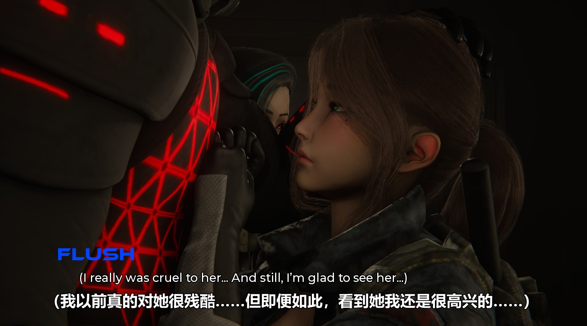

[](README.zh-CN.md)

#  RenpyLens

RenpyLens is a lightweight, real-time AI translation overlay for **Ren'Py** and **RPG Maker MV/MZ** games on Windows and macOS.

Drop a game executable into the app, choose a translation provider, and RenpyLens captures dialogue, speaker names, and visible choices through engine-native bridges. Translations appear in a movable overlay without replacing the game's original text.

Almost **all target languages** are supported.

The UI is currently available in **English, Simplified Chinese, Traditional Chinese, Japanese, Korean, and Russian**.

## 💬 Community and Support

- **Discord:** [https://discord.gg/c4putqY5zs](https://discord.gg/c4putqY5zs)
- **Chinese QQ group:** `1058127921`

Use these communities for support, feedback, release news, and early feature previews.

## ✨ Highlights

- **Drag-and-drop setup:** Drop the game's `.exe` or macOS `.app` into RenpyLens and launch it with the translation bridge.
- **Multiple game engines:** Supports Ren'Py and RPG Maker MV/MZ dialogue, speaker names, and visible choices.
- **RPGM tools:** Useful tools like text speed, dialogue opacity, dialogue rollback, faster movement, no-clip, battle outcomes and so on.
- **Flexible AI providers:**
  - **Built-in channel:** A streamlined, ready-to-use service with China mainland and global routes.
  - **Cloud providers:** OpenAI, Gemini, Anthropic Claude, DeepSeek, OpenRouter, Groq, MiniMax, SiliconFlow, Moonshot, xAI, Alibaba Qwen, Volcengine, Zhipu AI, and more.
  - **Ollama:** Run supported models locally and offline.
  - **Custom channels:** Add any OpenAI-compatible API endpoint.
- **Real-time overlay:** Display translations in a borderless, movable, resizable overlay above the game.
- **Translation workbench:** Review and edit recent dialogue and choices while playing.
- **Whole-game translation:** Scan supported game scripts and translate them in batches with progress tracking, rate limits, and cancellation.
- **Translation memory:** SQLite and in-memory caching reduce duplicate requests and preserve manual edits.
- **Localized interface:** Switch the application UI between languages from the main window.

## 📸 Screenshot



## 🆕 Release Notes

### v1.6.0 `Latest`

- **macOS support:** Added game `.app` launching, global shortcuts, overlay window handling, and `.app` packaging with layouts adapted for macOS.
- **Ren'Py translation and prediction:** Improved dialogue and choice extraction, text interpolation, and prediction of Python calls and custom screens.
- **Startup experience:** Improved repeated-launch handling, game process tracking, and multilingual layouts, and added launch and build scripts for Windows and macOS.

### v1.5.0~v1.5.6

- Added six-language interfaces, refreshed built-in routes and latency testing, expanded custom API channels, and introduced Discord support.
- Improved contextual translation with character profiles, branch-aware Ren'Py prediction, adaptive prefetching, and current-dialogue retranslation.
- Added configurable shortcuts, text copying, and scrollable long-text overlays; improved multi-display layout, editing, and pointer interactions.
- Expanded per-game RPG Maker tools with text speed, dialogue opacity, automatic advance, movement, collision, encounters, battle outcomes, dialogue rollback, and save-anywhere controls.
- Improved engine text extraction, Hook cleanup, model-output validation, localized API error guidance, Windows shortcut launching, and portable packaging with Expat dependency collection and UPX validation.

### v1.2.0–v1.3.0

- Added RPG Maker MV/MZ support and improved Ren'Py dialogue, speaker, choice, and continuation extraction.
- Introduced the translation workbench, overlay editing, whole-game batch translation, progress tracking, and manual translation caching.
- Improved prefetching, scan timing, launcher and wrapper executable tracking, and duplicate-launch prevention.
- Added API timeout and batch controls, clearer HTTP 429 feedback, and GitHub Release download and automatic update support.

### v1.1.0–v1.1.4

- Improved translation prompts, model behavior, caching, concurrency, and thinking-output cleanup.
- Expanded Ren'Py Hook and menu compatibility, including visible-choice translation.
- Added speaker names, italics, customizable fonts and colors, and always-on-top overlay behavior.
- Improved OpenAI-compatible endpoints, runtime provider switching, trial API status, and expiration checks.

## 🎮 Getting Started

1. **Download RenpyLens**
   - **Windows:** Download `RenpyLens_v1.6.0.exe` from the repository's **Releases** page.
   - **macOS:** Download `RenpyLens_v1.6.0_macos_arm64.zip` for Apple Silicon or `RenpyLens_v1.6.0_macos_x86_64.zip` for Intel, then extract and open `RenpyLens_v1.6.0.app`.
   - Alternatively, follow the development instructions below to run it from source.
2. **Choose a translation provider**
   - For the simplest setup, select **Built-in Channel** and choose **Get Trial API**. If you are not in mainland China, select **Global node** in **Route**.
   - To use your own service, open **Settings → API Settings** and configure a provider, Ollama, or a custom OpenAI-compatible channel.
1. **Select a game**
   - Drop the main `.exe` or macOS `.app` of a Ren'Py or RPG Maker MV/MZ game into the RenpyLens window.
   - If selected an RPG Maker MV/MZ game, you can choose to enable **RPGM tools** and choose the tools you want from the adjacent menu.
2. **Load the Hook and start**
   - Select **Load Hook and Start Game**. RenpyLens installs the appropriate bridge and launches the game.
   - Ren'Py uses a bridge inside `game/`; RPG Maker uses a plugin inside `js/plugins/`.
3. **Use the overlay**
   - Drag the overlay to reposition it.
   - Right-click the overlay for display controls, editing, workbench, and so on.
4. **Remove the Hook when needed**
   - Select **Uninstall Hook** to remove RenpyLens bridge files safely.

> **Model tip:** Real-time translation works best with models that do not emit long chain-of-thought or reasoning output. Such output increases latency and may appear in translations when a provider cannot disable it.

## 🛠️ Development

### Requirements

- Windows 10 or later recommended, or macOS
- Python 3.10+

### Clone and install

```powershell
git clone https://github.com/liuyuan-wen/RenpyLens.git
cd RenpyLens

python -m venv venv
venv\Scripts\activate
pip install -r requirements.txt
```

On macOS, create and activate the environment with:

```bash
python3 -m venv .venv
source .venv/bin/activate
python -m pip install -r requirements.txt
```

### Run from source

```powershell
python src/main.py
```

## 📦 Build Windows and macOS apps

Build on the target operating system.

```powershell
# PyInstaller must be installed in the selected Python environment.
python build.py

# Or select a specific Python interpreter.
python build.py --python "C:\path\to\venv\python.exe"
```

The build output is `RenpyLens_v1.6.0.exe`. If `upx.exe` is present in the project root, the build script uses it for compression by default. If the resulting executable is blocked by antivirus software or fails to start, build it without UPX:

```powershell
python build.py --noupx
```

On macOS, `python build.py` produces `RenpyLens_v1.6.0.app` without UPX. The **Build macOS** GitHub Actions workflow builds and archives separate Apple Silicon and Intel packages.

## 🧩 Project Structure

- **`src/main.py` and `src/settings_dialog.py`:** Main PyQt5 interface and application flow.
- **`src/workbench.py`:** Recent-entry review, manual editing, and whole-game translation status.
- **`src/updater.py`:** GitHub Release checks, downloads, and Windows self-update flow.
- **`src/engine_adapters.py`:** Engine detection, bridge installation, and offline RPG Maker event scanning.
- **`src/injector.py`:** Ren'Py detection, launch handling, and safe Hook installation.
- **`src/translator.py`:** Translation providers, connection pooling, batching, and rate-limit handling.
- **`src/hook_server.py`:** Local communication between RenpyLens and the injected game bridge.
- **`src/cache.py`:** SQLite-backed translation memory.
- **`assets/_translator_hook.rpy`:** Ren'Py runtime bridge.
- **`assets/RenpyLensBridge.js`:** RPG Maker MV/MZ runtime bridge.

## 📄 License

RenpyLens is open-source software licensed under the [GNU General Public License v3.0](LICENSE).
